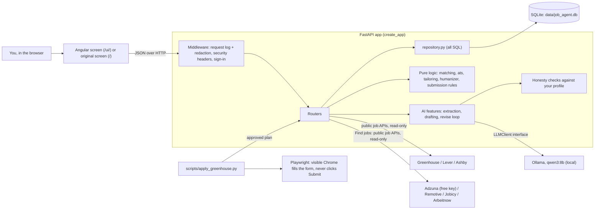

# Architecture

A local, single-user job application agent that anyone can run on their own computer at no cost: FastAPI,
SQLite, a local LLM through Ollama, and Playwright for page measurement and assisted apply. Each person's data
stays on their own machine; nothing is sent to a cloud AI service.

## Components

## Main user flow

1. **Profile:** `resume_import` reads an uploaded resume (PDF / Word / text) into a profile preview; the user
   saves it. An optional experience bank (`bank`) adds numbered records per employer.
2. **Find jobs:** `job_search` asks each source in parallel, then filters by title (synonym-aware), country
   (city / region / remote-region rules) and date range, de-duplicates across sources and sorts newest first.
3. **Apply:** `/search/apply` saves the job (`job_intake` reads its skills) and starts the application; the screen
   then asks for the tailored resume (`selection` → `tailoring` → `layout` two-page fit → `linefit`) and the cover
   letter (`drafting`). The user submits on the employer's page.
4. **Add job:** `job_intake` reads title, company, location and skills from a link and/or pasted description.

## Request flow

`browser → middleware (log, headers, sign-in) → router → repository / pure logic / AI → SQLite`

* **Routers** handle HTTP only: parse input, call logic, shape the response. No SQL.
* **repository.py** holds every SQL query, so moving to PostgreSQL would touch only it and `database.py`.
* **Pure modules** (`matching`, `ats`, `tailoring`, `humanizer`, `submission`) have no I/O, so they are
  tested directly and quickly.
* **AI** goes through a small `LLMClient` interface (`generate_json`, `status`). Tests swap in a fake;
  another provider could be added without touching the features.

## How the AI is kept honest

The model drafts, and code checks every draft against the profile you entered:

1. Every number in a draft must appear in your profile or the posting.
2. Every skill the draft claims must have evidence in your profile (`ats.find_evidence`).
3. Sentences that copy the posting instead of your facts are flagged.
4. A revise loop sends the problems back to the model and keeps a revision only if it is no less honest.
5. Resume bullets are selected deterministically from your own bullets; rewording is accepted only if
   it adds no new claims.

Remaining warnings are shown to you; nothing is hidden.

## Submission safety

Applications move through explicit states (`preparing → ready_for_review → submission_attempted →
submission_uncertain | submitted_confirmed → …`). The rules are enforced in code and the database:

* `submitted_confirmed` needs evidence (a confirmation page, number or email).
* A filled form is never treated as submitted. The filler never clicks Submit; you do.
* One application per job (a `UNIQUE` constraint), and duplicate jobs are detected by URL and by title + company.
* A request that was sent but not confirmed is recorded as **uncertain**, never as success.

## Data protection

| Risk | Control |
|---|---|
| Personal data on GitHub | `data/`, `.env` and `.venv` are git-ignored; only fictional examples are committed |
| Someone else opening the app | Listens on 127.0.0.1 only (Docker too); optional password (`APP_PASSWORD`) |
| Password guessing | Constant-time comparison, 60 s lockout after 5 wrong tries |
| Session theft | Random token, HttpOnly + SameSite=Strict cookie, 12 h expiry, revoked on sign-out |
| Personal data in logs | No query strings or bodies logged; emails and phone numbers masked in every line |
| Cached personal data | `Cache-Control: no-store` on API responses |
| Clickjacking / sniffing | `X-Frame-Options: DENY`, `X-Content-Type-Options: nosniff` |
| Tests touching real data | Every test uses a temporary database, a fake AI and fake job boards |

## Operations

* `GET /health`: database (required) and AI (optional). Returns `ok`, `degraded` (AI off, app still works)
  or `down` (503, database unreadable). `GET /health/live` is the Docker liveness check.
* Logs: one line per request with a request id (`X-Request-ID`), method, path, status and time,
  in `data/logs/app.log` (rotated at 1 MB, 5 files).
* Docker: `docker compose up --build`; data stays in `./data` on the Mac; Ollama stays on the Mac.

## Testing

| Layer | Tool | What it covers |
|---|---|---|
| Unit / API | pytest + TestClient | rules, validation, honesty checks, auth, health, logging |
| Angular units | Vitest + Angular TestBed | each page against a fake backend: rules shown, evidence required, errors |
| Browser | Playwright | user journeys on both screens, sign-in, assisted apply against a fake Greenhouse form |
| AI quality | `scripts/evaluate_ai.py` | extraction precision/recall and letter checks on fictional labelled cases |

## Key trade-offs

* **SQLite over PostgreSQL:** one user and one file, nothing to install. Fine at this scale.
* **Local 8B model over cloud APIs:** free and private, but slower and less fluent, which is why the code checks matter.
* **Plain HTML screen first, Angular last:** the workflow settled on a no-build page before moving to a framework.
  The Angular app uses standalone components, signals and hash URLs, so it is served as static files by FastAPI
  at /ui/ (same origin: the sign-in cookie just works, no CORS).
* **Assisted, not automatic, submission:** it is safer and more honest, and it keeps you in control of every application.
